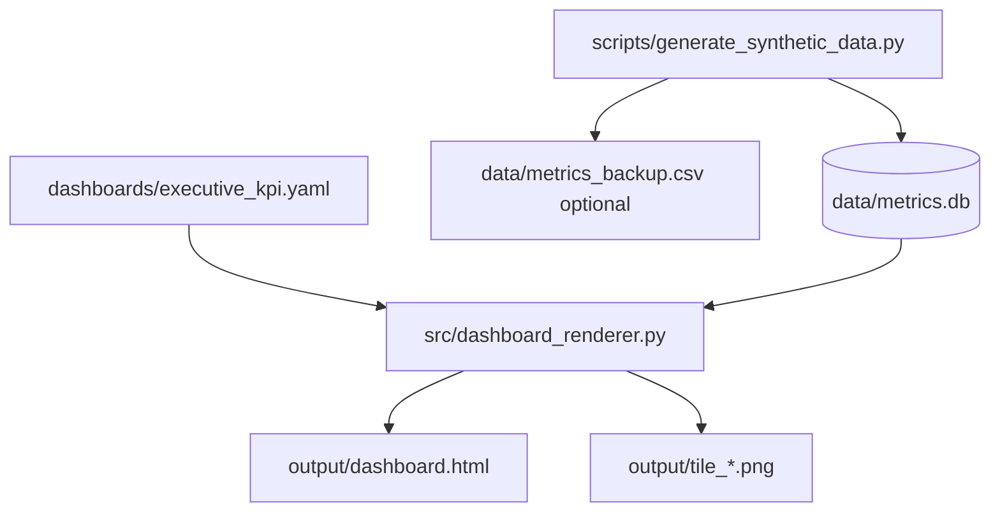
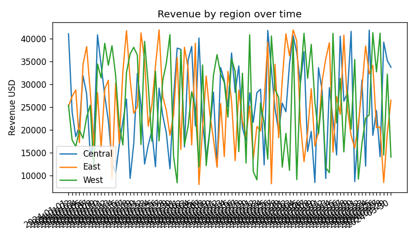

# Apache Superset Dashboard-as-Code Lab

**Author:** Faiz Elahi · **Type:** EDUCATIONAL LAB · **No Superset server required**

---

## Educational disclaimer / synthetic data

This lab teaches **dashboard-as-code** patterns using YAML chart specs and a **local Python renderer** that outputs HTML and PNG tiles. It is **not** a full Apache Superset export bundle, **not** a running Superset instance, and **not** connected to a production BI server.

Metrics in SQLite (`data/metrics.db`) are **synthetic** (90 days × three regions). Use the lab to practice git-reviewable dashboard metadata—not to publish official executive KPIs.

---

## Problem statement (detailed)

BI teams repeatedly lose dashboard logic in UI-only clicks. Modern practice treats datasets, charts, and layout as **version-controlled artifacts** reviewed in PRs like application code. Apache Superset supports export/import, but teams also want:

- **SQL definitions** colocated with charts,
- **Repeatable renders** for CI visual diff teaching,
- **Clear separation** between database, dataset SQL, and visualization type.

Students without a Superset Docker stack still need to **read YAML dashboard specs**, **execute chart SQL**, and **assemble a dashboard preview**. This lab generates SQLite data, defines `dashboards/executive_kpi.yaml`, and renders `output/dashboard.html` locally.

---

## Why this tool

| UI-only dashboards | Dashboard-as-code |
|--------------------|-------------------|
| Hard to diff | YAML/sql in git |
| Environment drift | Promote same spec dev→prod |
| Opaque SQL | Explicit queries per chart |

Superset remains the **reference model** for `viz_type` and dataset naming; the renderer is a **pedagogical stand-in** for Superset’s query + viz pipeline.

---

## Architecture





See: [`docs/architecture.md`](docs/architecture.md)

---

## Dataset dictionary (tables / columns)

**Table:** `daily_region_metrics` (SQLite)

| Column | Type | Description |
|--------|------|-------------|
| `metric_date` | DATE | Synthetic calendar day |
| `region` | TEXT | `East`, `West`, or `Central` |
| `revenue_usd` | REAL | Daily regional revenue |
| `orders` | INTEGER | Order count |

YAML references this table in dataset and chart SQL blocks inside `dashboards/executive_kpi.yaml`.

---

## Prerequisites

- Python 3.10+
- `pandas`, `sqlalchemy`, `pyyaml`, `matplotlib` (see `requirements.txt`)
- Web browser to open generated HTML

---

## Step-by-step: how to run

### Windows PowerShell

```powershell
cd apache-superset-dashboard-as-code-lab
python -m venv .venv
.\.venv\Scripts\Activate.ps1
pip install -r requirements.txt
python scripts/generate_synthetic_data.py
python scripts/run_lab.py
python scripts/render_docs_images.py
Start-Process output\dashboard.html
```

### Optional bash

```bash
cd apache-superset-dashboard-as-code-lab
python3 -m venv .venv && source .venv/bin/activate
pip install -r requirements.txt
python scripts/generate_synthetic_data.py
python scripts/run_lab.py
python scripts/render_docs_images.py
xdg-open output/dashboard.html 2>/dev/null || open output/dashboard.html
```

---

## File-by-file walkthrough

| Path | Role |
|------|------|
| `scripts/generate_synthetic_data.py` | Builds ~90 days × 3 regions into SQLite (+ CSV backup if present in script) |
| `dashboards/executive_kpi.yaml` | Dashboard title, dataset SQL, chart list with `viz_type` + query SQL |
| `src/dashboard_renderer.py` | Loads YAML, runs SQL via SQLAlchemy, matplotlib charts, HTML assembly |
| `scripts/run_lab.py` | Entrypoint calling renderer |
| `scripts/render_docs_images.py` | Sample tile for README |
| `output/` | Generated HTML and PNG tiles (created at runtime) |
| `data/metrics.db` | SQLite database (created by generator) |

### Charts defined in YAML (default)

1. **Revenue by region over time** — `viz_type: line`, daily revenue by region.
2. **Orders by region** — `viz_type: bar`, summed orders grouped by region.

---

## Expected outputs and how to interpret them

| Artifact | Interpretation |
|----------|----------------|
| `output/dashboard.html` | Static page embedding tile images and titles |
| `output/tile_1.png`, `tile_2.png` | Chart snapshots; use for docs or visual diff exercises |
| Console from renderer | Row counts per chart query—sanity check non-empty frames |

Line chart should show three colored series (regions). Bar chart should show three bars with distinct order totals.

---

## Results interpretation

- **SQL in YAML is source of truth** for what the renderer plots—change SQL and re-run to teach PR review.
- **matplotlib styling ≠ Superset theming**—focus on structure, not pixel-perfect match.
- **SQLite path** is relative to lab root; production would parameterize connection strings via env vars.

---

## Importing to real Superset (optional)

1. Load `data/metrics.db` or exported CSV into a database Superset can reach.
2. Create **datasets** using SQL from the YAML file.
3. Recreate charts in the UI matching `viz_type` and metrics—or import a real Superset export ZIP (this lab is a structural template, not a full ZIP export).

---

## Glossary (8+ terms)

1. **Dataset** — Superset object wrapping SQL against a database connection.
2. **Slice / chart** — Single visualization configuration bound to a dataset query.
3. **Dashboard-as-code** — Storing dashboard metadata in git for review and promotion.
4. **viz_type** — Visualization family (`line`, `bar`, `big_number`, etc.).
5. **Semantic layer** — Metrics/dimensions definition; here simplified to raw SQL in YAML.
6. **Tile** — One chart image embedded in static HTML output.
7. **SQLAlchemy engine** — Python DB connection used by local renderer.
8. **Promotion** — Moving dashboard specs dev → staging → prod with CI gates.
9. **Row-level security (RLS)** — Not implemented in this local lab.

---

## Common mistakes (5+)

1. Expecting YAML to **auto-import** into Superset without creating datasets/connections first.
2. **Hard-coding absolute SQLite paths**—breaks on other machines; use relative paths or env vars.
3. Opening HTML **before** running renderer—empty or stale tiles.
4. Editing YAML **indentation** incorrectly—breaks `yaml.safe_load`.
5. Confusing **sample PNG in docs/** with fresh `output/` tiles after data regen.
6. Committing **multi-MB SQLite** churn without noting regenerability.

---

## Exercises (5+)

1. Add third chart: **total revenue big number** (scalar SQL `SELECT SUM(revenue_usd) ...`).
2. Split YAML into `charts/` + `dashboards/` directories and merge in renderer.
3. Emit **JSON manifest** (chart title, png path, row count) for CI visual diff tooling.
4. Add **parameterized region filter** in SQL with Python string guardrails.
5. Mirror spec in **dbt metric** definitions from `dbt-healthcare-marts-lab` for cross-stack thinking.
6. Dockerize Superset optionally and manually recreate two charts for comparison.

---

## Limitations / simulation vs production

| This lab | Production Superset |
|----------|---------------------|
| Static HTML export | Interactive dashboards, filters |
| Local SQLite | Warehouse + connection secrets |
| matplotlib render | Superset viz plugins, caching |
| No auth | RBAC, row-level security |
| No async queries | Celery workers, queue limits |

---

## Related labs

- [`dbt-healthcare-marts-lab`](../dbt-healthcare-marts-lab/) — Modeled tables BI tools consume.
- [`caboodle-edw-star-schema-lab`](../caboodle-edw-star-schema-lab/) — Star schema KPI SQL source.
- [`databricks-lakehouse-medallion-lab`](../databricks-lakehouse-medallion-lab/) — Gold layer metrics feeding BI.
- [`hedis-quality-measures-lab`](../hedis-quality-measures-lab/) — Quality measure dashboards narrative.

---

**Author:** Faiz Elahi · Educational use only.
