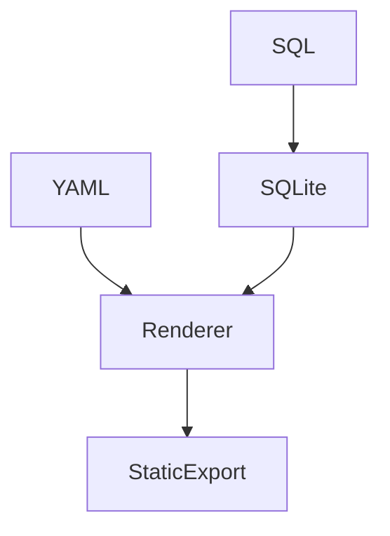

# Superset Dashboard-as-Code Architecture

YAML chart specs + SQL against local SQLite. Renderer produces static HTML mimicking Superset tiles.

Common mistake: expecting YAML to auto-import without manual dataset wiring in Superset UI.
